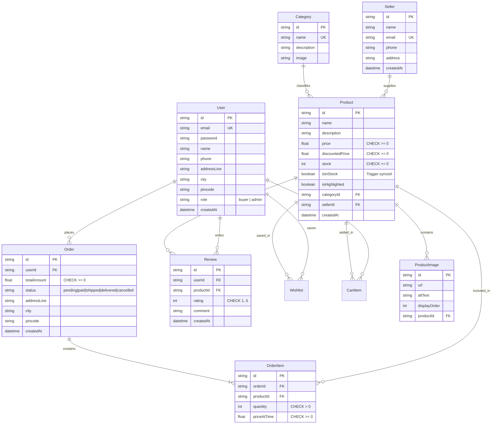

# System Architecture — Crystal Flora
**Concurrency-Safe E-Commerce System with Seller Analytics Dashboard**  
*Department of AI, SVNIT Surat — Course AI203 (DBMS)*

---

## 1. End-to-End System Pipeline

```
[Browser / React Client]
       │
       ▼ (HTTP / JSON / JWT Bearer)
[Next.js 16 App Router & Edge Middleware]
       │
       ├─► Static Content & SSR UI Pages
       ├─► Edge Route Guards (middleware.ts -> 307 on unauth)
       └─► Route Handlers (/api/*)
             │
             ▼
[Transaction Management & Service Layer]
       │
       ├─► lib/orders.ts (Concurrency Engine: FOR UPDATE + Serializable Tx)
       ├─► lib/analytics.ts (View fetchers & aggregations)
       └─► lib/auth.ts (JWT verification & admin role check)
             │
             ▼
[Prisma 7 ORM with PrismaPg Adapter]
       │
       ▼ (PostgreSQL Wire Protocol, Pooler 6543 / Direct 5432)
[Supabase PostgreSQL 15+]
       ├─► Relational Tables (3NF normalized)
       ├─► Integrity Constraints (Domain CHECKs, Composite Unique, Foreign Keys)
       ├─► PL/pgSQL Triggers (sync_is_in_stock)
       └─► Analytical Views (v_seller_revenue, v_product_velocity)
```

---

## 2. Entity-Relationship (ER) Diagram



---

## 3. Relational Schema & 3NF Normalization

### Decomposition & Normalization Proof
1. **1NF (First Normal Form)**:
   - Decomposed atomic multi-valued attributes: Product image URLs decomposed into child relational entity `ProductImage(id, productId, url, altText, displayOrder)`.
   - Backward-compatible scalar array `Product.images` maintained for zero downtime.
2. **2NF (Second Normal Form)**:
   - All non-key attributes are fully functionally dependent on the primary key.
   - `OrderItem` explicitly depends on composite surrogate key with separate `orderId` and `productId` references.
3. **3NF (Third Normal Form)**:
   - Removed transitive dependencies. `Seller` extracted into a 1st-class entity (`Seller(id, name, email, phone, address)`), eliminating transitive dependency between `Product` and seller contact details.

### Relational Constraints
- **Primary Keys**: Every relation possesses a unique CUID primary key.
- **Foreign Keys**:
  - `Product.categoryId` references `Category(id)` on delete RESTRICT.
  - `Product.sellerId` references `Seller(id)` on delete RESTRICT.
  - `OrderItem.orderId` references `Order(id)` on delete CASCADE.
  - `OrderItem.productId` references `Product(id)` on delete RESTRICT.
  - `Review.userId` references `User(id)` on delete CASCADE.
  - `Review.productId` references `Product(id)` on delete CASCADE.
- **Composite Unique Keys**:
  - `Review(userId, productId)`: Enforces that each buyer can submit at most 1 review per product (prevents duplicate submission races).
  - `Wishlist(userId, productId)`: Idempotent user wishlist tracking.
- **Domain CHECK Constraints (Migration 20261020135053)**:
  - `Product_price_non_negative`: `CHECK (price >= 0)`
  - `Product_stock_non_negative`: `CHECK (stock >= 0)`
  - `Product_discounted_price_valid`: `CHECK (discountedPrice IS NULL OR discountedPrice >= 0)`
  - `OrderItem_quantity_positive`: `CHECK (quantity > 0)`
  - `OrderItem_price_non_negative`: `CHECK (priceAtTime >= 0)`
  - `Order_total_non_negative`: `CHECK (totalAmount >= 0)`
  - `Review_rating_range`: `CHECK (rating >= 1 AND rating <= 5)`

---

## 4. PostgreSQL Triggers & Analytical Views

### 1. Stock Status Trigger (`sync_is_in_stock`)
Maintains catalog search and indexing performance by denormalizing `isInStock` without sacrificing consistency:
```sql
CREATE OR REPLACE FUNCTION fn_sync_is_in_stock()
RETURNS TRIGGER AS $$
BEGIN
  NEW."isInStock" := (NEW.stock > 0);
  RETURN NEW;
END;
$$ LANGUAGE plpgsql;

CREATE TRIGGER trg_sync_is_in_stock
BEFORE INSERT OR UPDATE OF stock ON "Product"
FOR EACH ROW
EXECUTE FUNCTION fn_sync_is_in_stock();
```

### 2. Seller Revenue View (`v_seller_revenue`)
Aggregates sales performance across vendors excluding cancelled orders:
```sql
CREATE OR REPLACE VIEW v_seller_revenue AS
SELECT
  s.id                                                  AS seller_id,
  s.name                                                AS seller_name,
  s.email                                               AS seller_email,
  COUNT(DISTINCT o.id)::int                             AS total_orders,
  COALESCE(SUM(oi.quantity), 0)::int                    AS units_sold,
  COALESCE(SUM(oi.quantity * oi."priceAtTime"), 0)::float AS total_revenue
FROM "Seller" s
LEFT JOIN "Product" p ON p."sellerId" = s.id
LEFT JOIN "OrderItem" oi ON oi."productId" = p.id
LEFT JOIN "Order" o ON o.id = oi."orderId" AND o.status != 'cancelled'
GROUP BY s.id, s.name, s.email;
```

### 3. Product Velocity View (`v_product_velocity`)
Ranks product velocity by gross merchandise volume (GMV):
```sql
CREATE OR REPLACE VIEW v_product_velocity AS
SELECT
  p.id                                                  AS "productId",
  p.name                                                AS "productName",
  c.name                                                AS "categoryName",
  COALESCE(s.name, 'In-House')                          AS "sellerName",
  p.stock                                               AS "currentStock",
  p.price                                               AS "price",
  COALESCE(SUM(oi.quantity), 0)::int                    AS "unitsSold",
  COALESCE(SUM(oi.quantity * oi."priceAtTime"), 0)::float AS "revenue"
FROM "Product" p
JOIN "Category" c ON c.id = p."categoryId"
LEFT JOIN "Seller" s ON s.id = p."sellerId"
LEFT JOIN "OrderItem" oi ON oi."productId" = p.id
LEFT JOIN "Order" o ON o.id = oi."orderId" AND o.status != 'cancelled'
GROUP BY p.id, p.name, c.name, s.name, p.stock, p.price
ORDER BY "revenue" DESC;
```

---

## 5. Concurrency Architecture & ACID Proof

### Concurrency Challenge
In high-demand flash sales, simultaneous checkout transactions reading stock before writing result in the classic **Lost Update Anomaly / TOCTOU Race Condition** (`stock = stock - 1`), causing inventory to drop below zero (overselling).

### Multi-Layer Defense in `lib/orders.ts` & `app/api/orders/route.ts`

```
Concurrent Order Requests (e.g. 50 parallel buyers)
       │
       ▼
[Deterministic Lock Ordering]
  Sorted Unique Product IDs: IDs.sort()  <-- Prevents deadlocks
       │
       ▼
[Pessimistic Row-Level Lock]
  SELECT id, stock, price, "discountedPrice"
  FROM "Product" WHERE id = ANY($ids)
  ORDER BY id FOR UPDATE                 <-- Serializes concurrent transactions
       │
       ▼
[In-Transaction Verification & Price Protection]
  Validate: locked.stock >= item.quantity
  Recompute: totalAmount = SUM(locked.price * qty)  <-- Client price tamper defense
       │
       ▼
[Conditional Atomic Decrement]
  UPDATE "Product" SET stock = stock - qty
  WHERE id = item.productId AND stock >= qty  <-- Defense in depth
       │
       ▼
[Serializable Conflict Retry Engine]
  Postgres 40001 / Prisma P2034 caught -> Jittered exponential backoff retry
       │
       ▼
[PostgreSQL Database CHECK Constraint]
  CHECK (stock >= 0)  <-- Hardware-level guarantee that stock never drops < 0
```

### Empirical Verification Result
When 50 concurrent transactions raced for a single unit of stock (`stock = 1`):
- **Succeeded**: Exactly 1 transaction committed (201 Created).
- **Rejected**: Exactly 49 transactions rolled back with `OUT_OF_STOCK` (400 Bad Request).
- **Database Catalog State**: 0 negative stock rows across all catalog tables.
- **Trigger Response**: `sync_is_in_stock` immediately flipped `isInStock` to `false`.