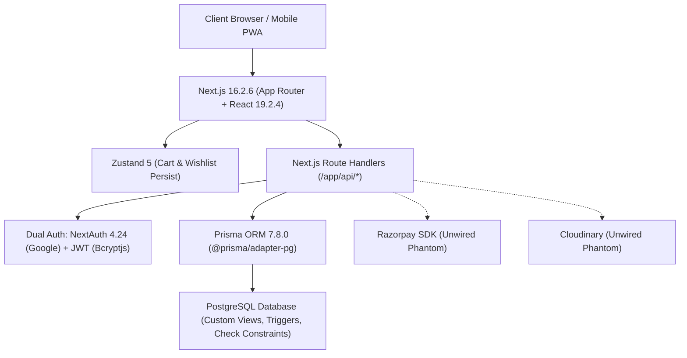

# 00 — System Overview & Executive Summary

## 1. Project Identity

| Attribute | Details |
| :--- | :--- |
| **Project Name** | **Crystal Flora** (`crystalfloraa`) |
| **Repository Root** | `c:\B.tech\3rd sem\DBMS\Project` |
| **Primary Purpose** | E-commerce platform for handcrafted fabric flowers, bouquets, jewelry (bracelets, necklaces), and custom floral keepsakes with advanced DBMS concurrency guarantees and seller analytics. |
| **Current Maturity Level** | **Late Prototype / Pre-Alpha (Phase 3 Complete / Concurrency-Hardened)** |
| **Target Runtime** | Node.js 20+, PostgreSQL 15+, Vercel Edge/Serverless |

---

## 2. Source Code & Git Metadata

- **Branch**: `main` (synced with `origin/main`)
- **Last Commit Hash**: `cdd698cfdc312a9fb422f96f8bb620ad3dd44bee`
- **Last Commit Message**: `removed DOCS`
- **Last Commit Author**: `gulam-solanki <solankigulamnabi6@gmail.com>`
- **Last Commit Date**: `Wed Oct 21 00:00:58 2026 +0530`
- **Recent Git Milestones**:
  - `7ba9105`: `feat: concurrency-safe e-commerce + seller analytics dashboard`
  - `43d019a`: `phase 3 completed`
  - `f01ccae`: `added admin dashbord ui`

---

## 3. High-Level Technology Stack



- **Framework**: [Next.js 16.2.6](file:///c:/B.tech/3rd%20sem/DBMS/Project/package.json#L25) (App Router, Turbopack compatible)
- **UI & Runtime**: [React 19.2.4](file:///c:/B.tech/3rd%20sem/DBMS/Project/package.json#L31) / [React DOM 19.2.4](file:///c:/B.tech/3rd%20sem/DBMS/Project/package.json#L32)
- **Styling**: [Tailwind CSS v4](file:///c:/B.tech/3rd%20sem/DBMS/Project/package.json#L51) + `@tailwindcss/postcss` + `tw-animate-css`
- **Database & Driver**: PostgreSQL with [Prisma 7.8.0](file:///c:/B.tech/3rd%20sem/DBMS/Project/package.json#L15), `@prisma/adapter-pg`, and `pg` (8.21.0)
- **State Management**: [Zustand 5.0.14](file:///c:/B.tech/3rd%20sem/DBMS/Project/package.json#L39) (with `persist` middleware for LocalStorage)
- **Component Primitives**: Radix UI Slot, Base UI (`@base-ui/react`), Lucide React, Sonner Toaster
- **Validation & Forms**: [Zod 4.4.3](file:///c:/B.tech/3rd%20sem/DBMS/Project/package.json#L38) & `react-hook-form` (currently declared but unused in frontend)

---

## 4. Repository Discovery & Folder Tree (Max 3 Levels)

```
c:\B.tech\3rd sem\DBMS\Project\
├── .gitignore
├── AGENTS.md                      # Agent boundary rules
├── CLAUDE.md                      # Claude instructions
├── components.json                # Shadcn component configuration
├── eslint.config.mjs              # ESLint 9 flat config
├── middleware.ts                  # Route protection middleware
├── next.config.ts                 # Next.js image remote patterns
├── package.json                   # Dependencies and scripts
├── package-lock.json
├── postcss.config.mjs             # Tailwind v4 PostCSS plugin
├── prisma.config.ts               # Prisma 7 schema & datasource configuration
├── README.md                      # Project documentation
├── tsconfig.json                  # TypeScript compiler settings
│
├── app/                           # Next.js App Router root
│   ├── favicon.ico
│   ├── globals.css                # Color variables, theme definitions
│   ├── layout.tsx                 # Root layout with fonts & providers
│   ├── page.tsx                   # Customer storefront home page
│   ├── about/page.tsx             # About page (Stub: "Coming soon")
│   ├── admin/                     # Admin portal
│   │   ├── layout.tsx             # Admin layout & client-side guard
│   │   ├── page.tsx               # Redirect to /admin/dashboard
│   │   ├── dashboard/page.tsx     # Concurrency stress tester & analytics UI
│   │   ├── orders/page.tsx        # Order status management table
│   │   ├── products/page.tsx      # Product catalog CRUD modal
│   │   └── stats/page.tsx         # Analytical SQL views inspection
│   ├── api/                       # API Route Handlers
│   │   ├── admin/                 # Admin restricted endpoints
│   │   │   ├── analytics/         # SQL Views endpoints (categories, seller, velocity)
│   │   │   ├── orders/            # Order list & PATCH status
│   │   │   ├── products/          # Product CRUD & [id] route
│   │   │   ├── simulate-race/     # 50-way concurrency race runner
│   │   │   └── stats/             # Dashboard KPI aggregations
│   │   ├── auth/                  # Authentication endpoints
│   │   │   ├── [...nextauth]/     # NextAuth Google provider handler
│   │   │   ├── login/             # Email/Password JWT generator
│   │   │   ├── me/                # Profile fetch & PATCH
│   │   │   └── register/          # User creation + bcrypt hashing
│   │   ├── categories/            # Category listing
│   │   ├── orders/                # Customer checkout & [id] & my-orders
│   │   ├── products/              # Catalog filter & search & [id]
│   │   ├── reviews/               # Product review creation
│   │   └── wishlist/              # Wishlist GET, POST, DELETE
│   ├── cart/page.tsx              # Shopping cart view
│   ├── checkout/page.tsx          # COD checkout & order submission
│   ├── edit-profile/page.tsx      # User profile edit form
│   ├── login/page.tsx             # Login form (JWT + NextAuth)
│   ├── orders/page.tsx            # Customer order history list
│   ├── orders/[id]/page.tsx       # Customer order tracker & status stepper
│   ├── products/page.tsx          # Search & category product gallery
│   ├── products/[id]/page.tsx     # Product detail showcase
│   ├── profile/page.tsx           # User account profile overview
│   ├── register/page.tsx          # User signup page
│   └── wishlist/page.tsx          # Customer saved items view
│
├── components/                    # Reusable React components
│   ├── admin/                     # Admin UI components
│   │   ├── admin-nav.tsx          # Sidebar navigation
│   │   ├── recent-orders.tsx      # [DEAD CODE - Unused]
│   │   ├── stat-card.tsx          # KPI metric card
│   │   ├── stats-card.tsx         # [DEAD CODE - Duplicate unused]
│   │   ├── status-badge.tsx       # [DEAD CODE - Duplicate unused]
│   │   └── top-products.tsx       # [DEAD CODE - Unused]
│   ├── cart/                      # Cart UI components
│   │   ├── bottom-nav.tsx         # Duplicate navigation with hardcoded styling
│   │   ├── cart-item.tsx          # Cart row component
│   │   ├── empty-cart.tsx         # Empty state banner
│   │   └── order-summary.tsx      # Subtotal / Total price card
│   └── ui/                        # Customer UI & Shadcn components
│       ├── badge.tsx, button.tsx, card.tsx, dialog.tsx, dropdown-menu.tsx
│       ├── bottom-nav.tsx, category-grid.tsx, hero-carousel.tsx, input.tsx
│       ├── label.tsx, navbar.tsx, photo-carousel.tsx, product-card.tsx
│       ├── product-detail.tsx, product-row.tsx, related-products.tsx
│       ├── reviews-section.tsx, session-provider.tsx, sheet.tsx, sonner.tsx
│       ├── star-rating.tsx, status-badge.tsx, table.tsx, theme-provider.tsx
│       ├── whatsapp-button.tsx, wishlist-content.tsx, wishlist-provider.tsx
│
├── lib/                           # Core utilities & domain logic
│   ├── analytics.ts               # Admin analytics fetchers & simulator caller
│   ├── auth.ts                    # JWT token verification (isAdmin, getUser)
│   ├── orders.ts                  # Concurrency-safe order placement engine
│   ├── prisma.ts                  # Prisma Client singleton with PG adapter
│   ├── product-data.ts            # Mock data fallback [MOCK DATA RESIDUE]
│   ├── store.ts                   # Zustand stores for cart & wishlist
│   ├── useAuth.ts                 # React hook for client-side session sync
│   └── utils.ts                   # clsx + tailwind-merge helper (cn)
│
├── prisma/                        # Database schemas & migrations
│   ├── schema.prisma              # Relational data models (User, Product, Order, etc.)
│   ├── seed.ts                    # Database seeder (51 users, 30 products, 200 orders)
│   └── migrations/
│       ├── 20261020135023_init/                       # Baseline tables
│       └── 20261020135053_constraints_triggers_views/ # SQL check constraints, views, triggers
│
└── public/                        # Static assets (images, SVGs)
    ├── images/logo.png
    └── *.svg
```

---

## 5. Build, Lint & Environment Status

| Metric | Current Status | Notes |
| :--- | :--- | :--- |
| **`npm run dev`** | Functional | Runs Next.js local server on port 3000. |
| **`npm run build`** | Runs `prisma generate && next build` | Requires valid `DATABASE_URL` in environment. |
| **`npm run lint`** | **FAILING (101 Problems)** | 48 errors, 53 warnings (mostly `@typescript-eslint/no-explicit-any`, unused vars, unescaped entities, and `react-hooks/set-state-in-effect`). |
| **`npm audit`** | **FAILING (37 Vulnerabilities)** | 3 Critical, 26 High, 7 Moderate, 1 Low (Next.js 16.2.6 and NextAuth 4.24.14 vulnerabilities). |
| **Environment Files** | **MISSING** | No `.env`, `.env.local`, or `.env.example` present in the repository. |

---

## 6. Executive Summary (10 Lines)

1. **Architecture Strength**: Crystal Flora incorporates an exceptional, production-grade concurrency order placement engine using PostgreSQL row-level locks (`SELECT ... FOR UPDATE`), serializable transaction isolation, and deterministic ID sorting.
2. **Database Integrity**: The relational database layer is fortified with custom domain check constraints, stock synchronization triggers, and high-performance SQL analytical views (`v_seller_revenue`, `v_product_velocity`).
3. **Severe Security Hole**: The application's server middleware ([`middleware.ts`](file:///c:/B.tech/3rd%20sem/DBMS/Project/middleware.ts)) does **not** protect `/admin` routes, leaving admin pages guarded solely by client-side redirects that leak initial markup.
4. **Environment Hazard**: No `.env.example` exists, and critical backend secrets (`DATABASE_URL`, `JWT_SECRET`, `GOOGLE_CLIENT_ID`, `GOOGLE_CLIENT_SECRET`) are assumed in code without centralized startup validation.
5. **Authentication Fracture**: Authentication is split haphazardly between custom JWT stored in `localStorage` and NextAuth Google session cookies, resulting in conflicting token handling and fragile synchronization.
6. **Schema Mismatch Bug**: Product creation/update handlers ([`app/api/admin/products/route.ts`](file:///c:/B.tech/3rd%20sem/DBMS/Project/app/api/admin/products/route.ts)) permit null `sellerId`, which crashes against the non-nullable foreign key defined in [`schema.prisma`](file:///c:/B.tech/3rd%20sem/DBMS/Project/prisma/schema.prisma#L50).
7. **Frontend Data Stubs**: The product detail view displays static mock fields (`originalPrice`, `shortDescription`) and hardcoded WhatsApp numbers rather than reading directly from database fields.
8. **Dead Code & Bloat**: Approximately 8 shadcn UI components, 4 admin dashboard widgets, and large third-party packages (`@tanstack/react-query`, `zod`, `razorpay`, `cloudinary`, `next-themes`) are unused dead weight.
9. **Zero Automated Testing**: The repository contains 0 unit, integration, or end-to-end tests; the concurrency engine relies solely on an interactive admin simulator.
10. **Immediate Recommendation**: Implement server-side middleware route gating for `/admin`, normalize schema nullability, upgrade Next.js to eliminate critical CVEs, and purge unused dependencies.
