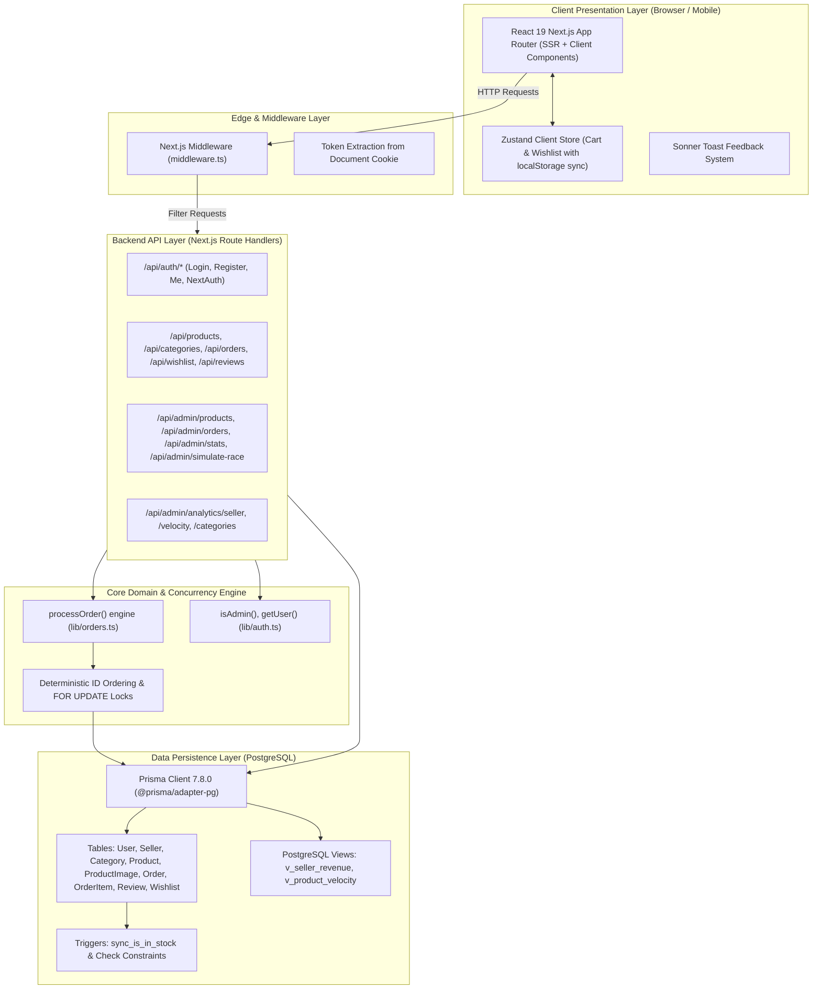
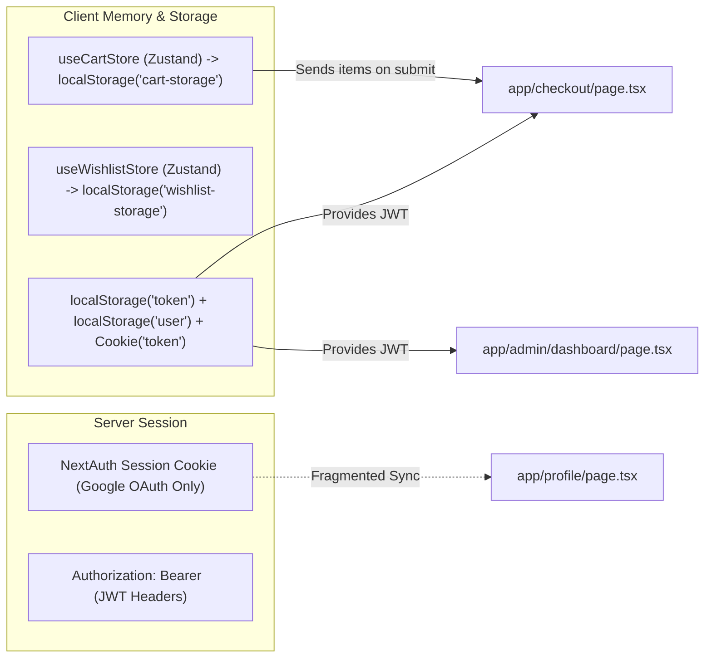

# 01 — System Architecture

## 1. High-Level Architecture Diagram

---

## 2. Layer-by-Layer Breakdown

### 2.1 Presentation Layer (Frontend)
- **Directory**: [`app/`](file:///c:/B.tech/3rd%20sem/DBMS/Project/app) and [`components/`](file:///c:/B.tech/3rd%20sem/DBMS/Project/components)
- **Rendering Strategy**: Mixed model. While Next.js App Router supports Server Components, almost **every single interactive page** (`app/page.tsx`, `app/products/page.tsx`, `app/checkout/page.tsx`, `app/orders/page.tsx`, `app/admin/dashboard/page.tsx`) explicitly opts into Client Components via `'use client'`.
- **Styling Architecture**: Tailwind CSS v4 using modern `@theme inline` tokens defined inside [`app/globals.css`](file:///c:/B.tech/3rd%20sem/DBMS/Project/app/globals.css).
- **Component Pattern**: Atomic / modular structure with specialized domain folders (`components/cart`, `components/admin`, `components/ui`).

### 2.2 Routing & Middleware Layer
- **File**: [`middleware.ts`](file:///c:/B.tech/3rd%20sem/DBMS/Project/middleware.ts)
- **Functionality**: Intercepts requests targeting `/checkout` and `/orders/:path*`. Checks for the presence of a `token` cookie. If absent, redirects to `/login?redirect=<path>`.
- **Architectural Flaw**: **Does NOT protect `/admin` or `/api/admin/*`!** The middleware config matcher is `['/checkout', '/orders/:path*']`. Admin pages are protected only client-side inside [`app/admin/layout.tsx`](file:///c:/B.tech/3rd%20sem/DBMS/Project/app/admin/layout.tsx#L12) via the `useAuth` hook.

### 2.3 Backend API Layer
- **Directory**: [`app/api/`](file:///c:/B.tech/3rd%20sem/DBMS/Project/app/api)
- **Design Style**: RESTful Route Handlers (`GET`, `POST`, `PATCH`, `DELETE`).
- **Authorization Enforcement**: Handled procedurally at the top of each route handler using helper functions from [`lib/auth.ts`](file:///c:/B.tech/3rd%20sem/DBMS/Project/lib/auth.ts):
  - `isAdmin(request)` verifies Bearer JWT token has `role === 'admin'`.
  - `getUser(request)` extracts decoded user payload (`id`, `email`, `role`).

### 2.4 Domain Logic & Concurrency Layer
- **File**: [`lib/orders.ts`](file:///c:/B.tech/3rd%20sem/DBMS/Project/lib/orders.ts)
- **Core Pattern**: 6-layer ACID transaction engine:
  1. Deduplicate & sort product IDs to prevent database deadlocks.
  2. Execute raw `SELECT id, stock, price, "discountedPrice" FROM "Product" WHERE id = ANY(...) ORDER BY id FOR UPDATE`.
  3. Validate real-time inventory from locked rows.
  4. Recalculate total order amount strictly from server-locked prices (immune to client tampering).
  5. Create `Order` and associated `OrderItem` rows.
  6. Execute atomic stock decrement with `where: { id, stock: { gte: quantity } }`.
  7. Automatic exponential backoff retry loop (up to 3 retries) on serialization conflicts or deadlocks (`P2034`).

### 2.5 Data Persistence Layer
- **Files**: [`prisma/schema.prisma`](file:///c:/B.tech/3rd%20sem/DBMS/Project/prisma/schema.prisma) and [`prisma/migrations/20261020135053_constraints_triggers_views/migration.sql`](file:///c:/B.tech/3rd%20sem/DBMS/Project/prisma/migrations/20261020135053_constraints_triggers_views/migration.sql)
- **Database Engine**: PostgreSQL via `@prisma/adapter-pg`.
- **DBMS Constructs**:
  - **Check Constraints**: `check_product_price_non_negative`, `check_product_stock_non_negative`, `check_review_rating_range`, `check_order_item_quantity_positive`.
  - **Database Triggers**: `trigger_sync_is_in_stock()` fires `BEFORE INSERT OR UPDATE OF stock ON "Product"` to automatically toggle `isInStock = false` when stock reaches `0`.
  - **SQL Analytical Views**: `v_seller_revenue` and `v_product_velocity` compute live GMV, units sold, and sales velocity without expensive repeated application-level joins.

---

## 3. Design Patterns & Code Conventions

| Pattern | Where Used | Evaluation |
| :--- | :--- | :--- |
| **Singleton Pattern** | [`lib/prisma.ts`](file:///c:/B.tech/3rd%20sem/DBMS/Project/lib/prisma.ts) | Prevents exhausting connection pool during Next.js hot module reloading. |
| **Pessimistic Row Locking** | [`lib/orders.ts`](file:///c:/B.tech/3rd%20sem/DBMS/Project/lib/orders.ts#L37) | `SELECT ... FOR UPDATE` ensures concurrent orders cannot oversell limited inventory. |
| **Deadlock Avoidance via Sorting** | [`lib/orders.ts`](file:///c:/B.tech/3rd%20sem/DBMS/Project/lib/orders.ts#L27) | Locking multiple items in deterministic alphabetical order guarantees no circular lock wait. |
| **Optimistic Retry Backoff** | [`lib/orders.ts`](file:///c:/B.tech/3rd%20sem/DBMS/Project/lib/orders.ts#L115) | Catches serialization conflicts with jittered exponential backoff. |
| **Client State Persistence** | [`lib/store.ts`](file:///c:/B.tech/3rd%20sem/DBMS/Project/lib/store.ts) | Zustand `persist` saves cart and wishlist in `localStorage`. |
| **Procedure Duplication** | [`app/api/orders/route.ts`](file:///c:/B.tech/3rd%20sem/DBMS/Project/app/api/orders/route.ts) | **Anti-Pattern**: Duplicates the entire `processOrder` transaction logic instead of importing from `lib/orders.ts`. |
| **Client-Only Auth Guard** | [`app/admin/layout.tsx`](file:///c:/B.tech/3rd%20sem/DBMS/Project/app/admin/layout.tsx) | **Anti-Pattern**: Client component renders spinner while verifying token, exposing route to direct scraper access. |

---

## 4. State Management Architecture

---

## 5. Architectural Issues & Tech Debt

| File Path | Issue | Severity | Fix Suggestion |
| :--- | :--- | :--- | :--- |
| [`middleware.ts`](file:///c:/B.tech/3rd%20sem/DBMS/Project/middleware.ts#L24) | Server middleware excludes `/admin` and `/api/admin/:path*` from matcher. Anyone can probe the route. | **Critical** | Expand `config.matcher` to include `/admin/:path*` and verify admin JWT or session cookie server-side. |
| [`app/api/orders/route.ts`](file:///c:/B.tech/3rd%20sem/DBMS/Project/app/api/orders/route.ts#L58-L135) | Redundantly re-implements the 80-line concurrency transaction that already exists in `lib/orders.ts`. | **High** | Refactor route handler to call `processOrder(input)` directly from `lib/orders.ts`. |
| [`app/layout.tsx`](file:///c:/B.tech/3rd%20sem/DBMS/Project/app/layout.tsx#L39) | App layout wraps `<NextAuthProvider>` but the primary auth mechanism is custom JWT stored in `localStorage`. | **Medium** | Unify under a single standard: either migrate fully to NextAuth or retire NextAuth in favor of a clean JWT cookie strategy. |
| [`components/cart/bottom-nav.tsx`](file:///c:/B.tech/3rd%20sem/DBMS/Project/components/cart/bottom-nav.tsx) | Redundant duplicate of `components/ui/bottom-nav.tsx` with conflicting route target (`/categories` which 404s). | **Medium** | Delete `components/cart/bottom-nav.tsx` and standardize on `components/ui/bottom-nav.tsx`. |
| [`app/page.tsx`](file:///c:/B.tech/3rd%20sem/DBMS/Project/app/page.tsx#L1) | Homepage is fully client-side rendered (`'use client'`), forfeiting Next.js SSR SEO benefits. | **Medium** | Refactor homepage into a Server Component that fetches initial products and categories during SSR. |
