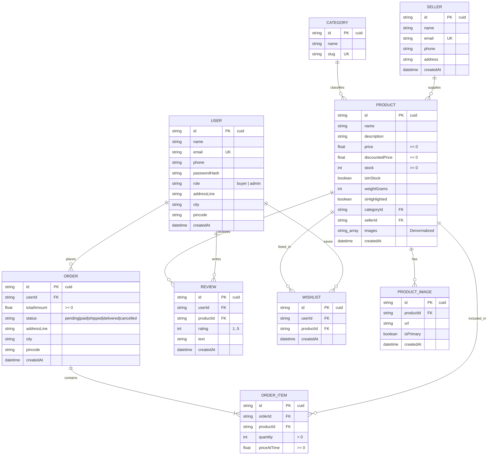

# 03 — Database & Storage Architecture

## 1. Database Engine & ORM Configuration

- **Database Engine**: **PostgreSQL** (version 14+ recommended, tested with Postgres 15/16)
- **Object-Relational Mapping (ORM)**: **Prisma ORM 7.8.0**
- **Connection Driver**: Modern decoupled driver using `@prisma/adapter-pg` with native `pg` connection pool.
- **Datasource Connection**: Defined in [`prisma.config.ts`](file:///c:/B.tech/3rd%20sem/DBMS/Project/prisma.config.ts) and initialized in [`lib/prisma.ts`](file:///c:/B.tech/3rd%20sem/DBMS/Project/lib/prisma.ts) via `process.env.DATABASE_URL`.

---

## 2. Entity-Relationship (ER) Diagram



---

## 3. Schema Catalog & Index Analysis

| Table | Primary Key | Foreign Keys | Unique Constraints | Custom Indexes |
| :--- | :--- | :--- | :--- | :--- |
| **`User`** | `id` (cuid) | — | `email` | Index on `email` (implicit unique) |
| **`Seller`** | `id` (cuid) | — | `email` | Index on `email` (implicit unique) |
| **`Category`** | `id` (cuid) | — | `slug` | Index on `slug` (implicit unique) |
| **`Product`** | `id` (cuid) | `categoryId` -> Category(`id`)<br>`sellerId` -> Seller(`id`) | — | `@@index([categoryId])`<br>`@@index([sellerId])` |
| **`ProductImage`**| `id` (cuid) | `productId` -> Product(`id`) ON DELETE CASCADE | — | `@@index([productId])` |
| **`Order`** | `id` (cuid) | `userId` -> User(`id`) | — | `@@index([userId])` |
| **`OrderItem`** | `id` (cuid) | `orderId` -> Order(`id`) ON DELETE CASCADE<br>`productId` -> Product(`id`) ON DELETE RESTRICT | — | `@@index([orderId])`<br>`@@index([productId])` |
| **`Review`** | `id` (cuid) | `userId` -> User(`id`) ON DELETE CASCADE<br>`productId` -> Product(`id`) ON DELETE CASCADE | `[userId, productId]` | `@@index([userId])`<br>`@@index([productId])` |
| **`Wishlist`** | `id` (cuid) | `userId` -> User(`id`) ON DELETE CASCADE<br>`productId` -> Product(`id`) ON DELETE CASCADE | `[userId, productId]` | `@@index([userId])`<br>`@@index([productId])` |

---

## 4. Advanced PostgreSQL Features (DDL Constraints, Triggers, Views)

Defined in [`prisma/migrations/20261020135053_constraints_triggers_views/migration.sql`](file:///c:/B.tech/3rd%20sem/DBMS/Project/prisma/migrations/20261020135053_constraints_triggers_views/migration.sql):

### 4.1 Domain & Check Constraints
```sql
ALTER TABLE "Product" 
  ADD CONSTRAINT check_product_price_non_negative CHECK (price >= 0),
  ADD CONSTRAINT check_product_stock_non_negative CHECK (stock >= 0),
  ADD CONSTRAINT check_product_discounted_price CHECK ("discountedPrice" IS NULL OR "discountedPrice" >= 0);

ALTER TABLE "Review"
  ADD CONSTRAINT check_review_rating_range CHECK (rating >= 1 AND rating <= 5);

ALTER TABLE "OrderItem"
  ADD CONSTRAINT check_order_item_quantity_positive CHECK (quantity > 0),
  ADD CONSTRAINT check_order_item_price_non_negative CHECK ("priceAtTime" >= 0);

ALTER TABLE "Order"
  ADD CONSTRAINT check_order_total_non_negative CHECK ("totalAmount" >= 0);
```

### 4.2 Stock Synchronization Trigger
```sql
CREATE OR REPLACE FUNCTION trigger_sync_is_in_stock()
RETURNS TRIGGER AS $$
BEGIN
  IF NEW.stock <= 0 THEN
    NEW."isInStock" := false;
  ELSE
    NEW."isInStock" := true;
  END IF;
  RETURN NEW;
END;
$$ LANGUAGE plpgsql;

CREATE TRIGGER sync_is_in_stock
BEFORE INSERT OR UPDATE OF stock ON "Product"
FOR EACH ROW EXECUTE FUNCTION trigger_sync_is_in_stock();
```

### 4.3 Database Analytical Views
1. **`v_seller_revenue`**: Aggregates seller orders, units sold, and total GMV excluding cancelled orders.
2. **`v_product_velocity`**: Sorts products by units sold and gross revenue for real-time ranking on the admin dashboard.

---

## 5. Normalization & Information Model Audit (3NF / MIMP)

### 5.1 Redundancy & Normalization Violations
1. **Dual Image Representation (Violates 3NF / Redundancy)**:
   - The `Product` model has `images String[] @default([])` (denormalized array).
   - Simultaneously, a separate relational table `ProductImage` exists (`productId`, `url`, `isPrimary`).
   - The application frontend reads `product.images[0]`, leaving the `ProductImage` table largely unused and desynchronized.
2. **Denormalized Snapshot in Order**:
   - `Order` captures `addressLine`, `city`, `pincode` at the time of checkout. This is **good practice** (point-in-time snapshot so future profile address changes do not corrupt past delivery logs).
3. **Price Snapshotting**:
   - `OrderItem.priceAtTime` captures historical price correctly, preventing product price revisions from retroactively modifying order values.

---

## 6. Seed Data Status

The seeder in [`prisma/seed.ts`](file:///c:/B.tech/3rd%20sem/DBMS/Project/prisma/seed.ts) populates:
- **3 Sellers**: Floral Co, Gardenia, Bloom House
- **6 Categories**: Bouquets, Bracelets, Necklaces, Hair Clips, Keychains, Keepsakes
- **51 Users**: 1 Admin (`admin@demo.com` / `admin1234`) + 50 Buyers (`demo1234`)
- **30 Products**: 5 per category (configured with 3 items with `stock=1` to allow instant concurrency stress-testing and 5 with `stock < 5` to test low-stock alerts)
- **200 Orders**: Realistic status distribution (140 delivered, 30 pending, 20 shipped, 10 cancelled)
- **150 Customer Reviews**: Unique pairs across products and buyers

---

## 7. Database Issues & Recommendations

| File Path | Issue | Severity | Fix Suggestion |
| :--- | :--- | :--- | :--- |
| [`prisma/schema.prisma`](file:///c:/B.tech/3rd%20sem/DBMS/Project/prisma/schema.prisma#L50-L51) | `sellerId String` is non-nullable in schema, but admin API routes allow null, causing runtime insert crashes. | **High** | Either make `sellerId String?` optional in Prisma schema or enforce a default platform seller ID in the API. |
| [`prisma/schema.prisma`](file:///c:/B.tech/3rd%20sem/DBMS/Project/prisma/schema.prisma#L52-L53) | Duplicate data model: `images String[]` on `Product` coexists with `ProductImage` table. | **Medium** | Standardize on one approach: either drop `ProductImage` table or migrate API/frontend to use `ProductImage`. |
| [`prisma/schema.prisma`](file:///c:/B.tech/3rd%20sem/DBMS/Project/prisma/schema.prisma#L60) | Product `stock` is of type `Int`. When concurrent writes occur, Prisma check constraints stop negative stock, but lock timeouts can occur under extreme bursts. | **Low** | Increase transaction timeout in `lib/orders.ts` (currently 10000ms) or add read replica pooling for catalog reads. |
