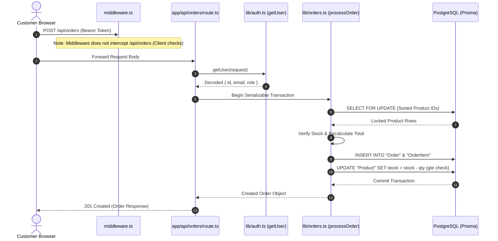

# 04 — Backend API & Services Architecture

## 1. Complete API Route Matrix

| Method | Endpoint | Auth Required | Request Body / Params | Purpose & Logic |
| :--- | :--- | :--- | :--- | :--- |
| `POST` | `/api/auth/register` | None (Public) | `{ name, email, phone?, password }` | Hashes password with `bcryptjs` (salt 10); creates `User` (role="buyer"). |
| `POST` | `/api/auth/login` | None (Public) | `{ email, password }` | Compares password hash; issues signed JWT (7-day expiry). |
| `GET` | `/api/auth/me` | Bearer JWT | None | Returns authenticated user profile fields (`id, name, email, phone, role`). |
| `PATCH` | `/api/auth/me` | Bearer JWT or NextAuth | `{ name, phone, addressLine, city, pincode }` | Updates user profile and default shipping address. |
| `GET/POST`| `/api/auth/[...nextauth]` | Public / OAuth | OAuth credentials | NextAuth handler for Google OAuth sign-in and user upsert. |
| `GET` | `/api/categories` | None (Public) | None | Fetches all categories sorted alphabetically. |
| `GET` | `/api/products` | None (Public) | Query: `?search=...&category=...` | Filters products by search query / category slug where `isInStock: true`. |
| `GET` | `/api/products/[id]` | None (Public) | Path: `id` | Fetches single product, category metadata, and customer reviews. |
| `POST` | `/api/orders` | Bearer JWT | `{ items, addressLine, city, pincode }` | Executes serializable row-locked order placement & stock decrements. |
| `GET` | `/api/orders/my-orders` | Bearer JWT | None | Retrieves order history for the currently logged-in user. |
| `GET` | `/api/orders/[id]` | Bearer JWT | Path: `id` | Retrieves single order details (ownership or admin role verified). |
| `GET` | `/api/wishlist` | Bearer JWT | None | Fetches user's saved wishlist products. |
| `POST` | `/api/wishlist` | Bearer JWT | `{ productId }` | Adds product to wishlist idempotently (returns 200 if already present). |
| `DELETE` | `/api/wishlist` | Bearer JWT | Query: `?productId=...` or Body | Removes product from wishlist. |
| `POST` | `/api/reviews` | Bearer JWT | `{ productId, rating, text }` | Creates review (enforces 1-5 rating, unique per user/product). |
| `GET` | `/api/admin/products` | Admin Bearer JWT | None | Fetches full catalog including stock and seller relation. |
| `POST` | `/api/admin/products` | Admin Bearer JWT | `{ name, description, price, stock, categoryId, sellerId?, ... }` | Inserts new product. |
| `PATCH` | `/api/admin/products/[id]` | Admin Bearer JWT | Whitelist fields | Updates product fields. |
| `DELETE` | `/api/admin/products/[id]` | Admin Bearer JWT | Path: `id` | Deletes product (catches FK violations `P2003` -> returns 409). |
| `GET` | `/api/admin/orders` | Admin Bearer JWT | None | Returns all platform orders with buyer and item breakdowns. |
| `PATCH` | `/api/admin/orders` | Admin Bearer JWT | `{ orderId, status }` | Updates order state (`pending`, `paid`, `shipped`, `delivered`, `cancelled`). |
| `GET` | `/api/admin/stats` | Admin Bearer JWT | None | Computes total GMV, order count, pending count, low stock, and top 5 products. |
| `GET` | `/api/admin/analytics/seller` | Admin Bearer JWT | None | Queries PostgreSQL view `v_seller_revenue`. |
| `GET` | `/api/admin/analytics/velocity` | Admin Bearer JWT | None | Queries PostgreSQL view `v_product_velocity`. |
| `GET` | `/api/admin/analytics/categories` | Admin Bearer JWT | None | Computes product counts and revenue per category via raw SQL. |
| `POST` | `/api/admin/simulate-race` | Admin Bearer JWT | `{ productId, buyers, resetAfter }` | Runs 50 parallel transaction threads to prove zero-overselling. |

---

## 2. Controllers, Services & Middleware Architecture

---

## 3. Authentication & Authorization Strategy

1. **Dual System Conflict**:
   - Primary: **Custom JWT** generated in [`app/api/auth/login/route.ts`](file:///c:/B.tech/3rd%20sem/DBMS/Project/app/api/auth/login/route.ts#L38) using `jsonwebtoken.sign()` with secret `process.env.JWT_SECRET!`. Stored in client `localStorage`.
   - Secondary: **NextAuth** in [`app/api/auth/[...nextauth]/route.ts`](file:///c:/B.tech/3rd%20sem/DBMS/Project/app/api/auth/[...nextauth]/route.ts) with Google Provider.
   - Patchwork in [`app/api/auth/me/route.ts`](file:///c:/B.tech/3rd%20sem/DBMS/Project/app/api/auth/me/route.ts#L46-L57): Tries `getUser(request)` first; falls back to `getServerSession()`.
2. **Missing Token Expiration Handling**:
   - Tokens last 7 days (`expiresIn: '7d'`), but there is no refresh token rotation or revocation blacklist.
3. **Password Storage**:
   - Stored in `User.passwordHash` hashed with `bcryptjs` at work factor 10.

---

## 4. Rate Limiting, Input Validation & Error Handling

- **Rate Limiting**: **MISSING**. No rate limiting middleware (such as Redis Upstash or memory token bucket) is present. An attacker can hammer `/api/auth/login` or `/api/admin/simulate-race`.
- **Input Validation**:
  - `zod` is installed in `package.json` (`^4.4.3`), but **not a single API route uses Zod schemas**!
  - Routes perform basic manual checking (`if (!name || !price)`), making them vulnerable to unexpected types or prototype pollution.
- **Error Handling**:
  - Prisma error codes are handled selectively: `P2002` (Unique constraint violation), `P2025` (Record not found), `P2003` (Foreign key constraint violation), and `P2034` (Serialization conflict).
  - Uncaught exceptions return generic `500 { error: '...' }` JSON payloads.

---

## 5. API Issues & Recommendations

| File Path | Issue | Severity | Fix Suggestion |
| :--- | :--- | :--- | :--- |
| [`app/api/admin/products/route.ts`](file:///c:/B.tech/3rd%20sem/DBMS/Project/app/api/admin/products/route.ts#L64) | `sellerId: sellerId ? String(sellerId) : null` crashes Prisma if `sellerId` is null because schema specifies `sellerId String`. | **High** | Assign a default platform seller or make `sellerId` optional in `schema.prisma`. |
| [`app/api/orders/route.ts`](file:///c:/B.tech/3rd%20sem/DBMS/Project/app/api/orders/route.ts#L58-L135) | Massive 80-line duplication of `processOrder` logic from `lib/orders.ts`. Creates maintenance drift. | **Medium** | Replace inline transaction with `await processOrder(...)` from `lib/orders.ts`. |
| Whole `/app/api/*` | Absence of schema validation (Zod is installed but unused). | **Medium** | Define Zod schemas for all request payloads (`OrderInputSchema`, `ProductInputSchema`, etc.). |
| Whole `/app/api/*` | No rate limiting on authentication or transaction endpoints. | **Medium** | Implement IP/Token based rate limiting middleware. |
