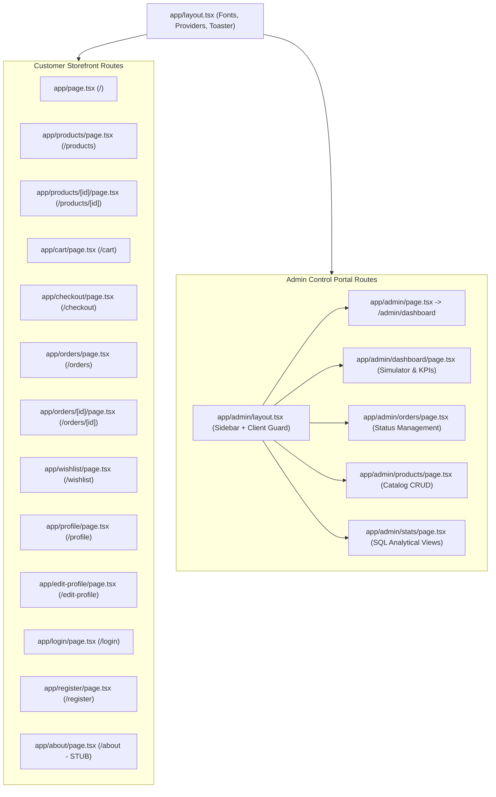

# 05 — Frontend Architecture & Pages

## 1. Page & Route Tree

---

## 2. Page Specifications & API Integration Points

| Page Path | Client/Server | State / Store Used | API Endpoints Invoked | Key UX Features |
| :--- | :--- | :--- | :--- | :--- |
| [`app/page.tsx`](file:///c:/B.tech/3rd%20sem/DBMS/Project/app/page.tsx) | Client (`'use client'`) | React `useState` | `GET /api/products` `GET /api/categories` | Hero banner slider, Category icon grid, Category product rows, WhatsApp shortcut. |
| [`app/products/page.tsx`](file:///c:/B.tech/3rd%20sem/DBMS/Project/app/products/page.tsx) | Client (`Suspense`) | React `useState` | `GET /api/products?search=&category=` | Responsive product grid, stock status overlays, sale badges, query sync. |
| [`app/products/[id]/page.tsx`](file:///c:/B.tech/3rd%20sem/DBMS/Project/app/products/[id]/page.tsx) | Client | `useCartStore`, React state | `GET /api/products/[id]` | Photo carousel, quantity stepper, WhatsApp custom order button, sticky cart bar. |
| [`app/cart/page.tsx`](file:///c:/B.tech/3rd%20sem/DBMS/Project/app/cart/page.tsx) | Client | `useCartStore` (Zustand) | None (Local store) | Quantity adjustment, item deletion, live subtotal computation, checkout redirect. |
| [`app/checkout/page.tsx`](file:///c:/B.tech/3rd%20sem/DBMS/Project/app/checkout/page.tsx) | Client | `useCartStore`, `useAuth` | `POST /api/orders` | Address entry (with 6-digit PIN regex), COD selector, concurrency-safe submission. |
| [`app/orders/page.tsx`](file:///c:/B.tech/3rd%20sem/DBMS/Project/app/orders/page.tsx) | Client | `useAuth`, React state | `GET /api/orders/my-orders` | Visual status pills, item image thumbnails, order count badges, empty state. |
| [`app/orders/[id]/page.tsx`](file:///c:/B.tech/3rd%20sem/DBMS/Project/app/orders/[id]/page.tsx) | Client | `useCartStore`, `useAuth` | `GET /api/orders/[id]` | 4-step order progress timeline, itemized pricing breakdown, 1-click reorder button. |
| [`app/wishlist/page.tsx`](file:///c:/B.tech/3rd%20sem/DBMS/Project/app/wishlist/page.tsx) | Client | React `useState` | `GET /api/wishlist` `DELETE /api/wishlist` | Saved item grid, instant remove handler, link to product detail. |
| [`app/profile/page.tsx`](file:///c:/B.tech/3rd%20sem/DBMS/Project/app/profile/page.tsx) | Client | NextAuth `useSession`, `localStorage` | `GET /api/auth/me` `GET /api/orders/my-orders` `GET /api/wishlist` | Initials monogram avatar, metric counters (orders, wishlist), account links. |
| [`app/edit-profile/page.tsx`](file:///c:/B.tech/3rd%20sem/DBMS/Project/app/edit-profile/page.tsx) | Client | React `useState` | `GET /api/auth/me` `PATCH /api/auth/me` | Name, phone, shipping address editor with Sonner toast feedback. |
| [`app/login/page.tsx`](file:///c:/B.tech/3rd%20sem/DBMS/Project/app/login/page.tsx) | Client | React `useState` | `POST /api/auth/login` | Email/password submission, password visibility toggle, role-based redirect. |
| [`app/register/page.tsx`](file:///c:/B.tech/3rd%20sem/DBMS/Project/app/register/page.tsx) | Client | React `useState` | `POST /api/auth/register` `POST /api/auth/login` | Full name, email, phone, password confirmation, auto-login upon creation. |
| [`app/about/page.tsx`](file:///c:/B.tech/3rd%20sem/DBMS/Project/app/about/page.tsx) | Server | None | None | Stub text: `"Coming soon"`. |
| [`app/admin/dashboard/page.tsx`](file:///c:/B.tech/3rd%20sem/DBMS/Project/app/admin/dashboard/page.tsx) | Client | React `useState` | `GET /api/admin/stats` `GET /api/admin/analytics/seller` `POST /api/admin/simulate-race` | Wired KPI cards, 50-way concurrency race runner, seller revenue bar graph. |
| [`app/admin/orders/page.tsx`](file:///c:/B.tech/3rd%20sem/DBMS/Project/app/admin/orders/page.tsx) | Client | React `useState` | `GET /api/admin/orders` `PATCH /api/admin/orders` | Searchable orders table, instant status dropdown update with feedback toast. |
| [`app/admin/products/page.tsx`](file:///c:/B.tech/3rd%20sem/DBMS/Project/app/admin/products/page.tsx) | Client | React `useState` | `GET /api/admin/products` `POST /api/admin/products` `PATCH /api/admin/products/[id]` `DELETE /api/admin/products/[id]` | Full CRUD inventory table, modal form with category and seller pickers. |
| [`app/admin/stats/page.tsx`](file:///c:/B.tech/3rd%20sem/DBMS/Project/app/admin/stats/page.tsx) | Client | React `useState` | `GET /api/admin/stats` `GET /api/admin/analytics/seller` `GET /api/admin/analytics/velocity` `GET /api/admin/analytics/categories` | Complete SQL view inspection tables (`v_seller_revenue`, `v_product_velocity`). |

---

## 3. Forms & Client Validation Analysis

- **Register Form (`app/register/page.tsx`)**:
  - Implements custom JavaScript validation for email structure (`/^[^\s@]+@[^\s@]+\.[^\s@]+$/`), phone requirement, minimum 8-character password, and password match confirmation.
- **Checkout Form (`app/checkout/page.tsx`)**:
  - Validates full name, address line, city, and strictly enforces 6-digit Indian PIN code regex (`/^[0-9]{6}$/`).
- **Product Admin Modal (`app/admin/products/page.tsx`)**:
  - Requires name, price, stock, and category ID.
- **Form Architecture Flaw**: Despite having `react-hook-form` and `zod` installed in `package.json`, none of the forms use them, relying instead on manual `useState` objects and imperative loops.

---

## 4. Frontend Performance & Bundle Considerations

1. **Client Component Overload**:
   - Nearly all pages are declared with `'use client'`. This sends excessive JavaScript to the browser and degrades initial time-to-interactive (TTI) and First Contentful Paint (FCP).
2. **Image Optimization**:
   - Standard Next.js `<Image />` is used in `components/ui/navbar.tsx`, `app/checkout/page.tsx`, and `app/products/page.tsx`.
   - **Violation**: [`components/ui/photo-carousel.tsx`](file:///c:/B.tech/3rd%20sem/DBMS/Project/components/ui/photo-carousel.tsx#L61) and [`components/ui/related-products.tsx`](file:///c:/B.tech/3rd%20sem/DBMS/Project/components/ui/related-products.tsx#L30) use raw unoptimized HTML `` tags (`@next/next/no-img-element`), bypassing Next.js responsive image resizing and WebP conversion.
3. **Dead Code Impact**:
   - Unused packages (`@tanstack/react-query`, `zod`, `@base-ui/react`) and unused shadcn components add unnecessary bytes to the dependency graph.

---

## 5. Frontend Issues Table

| File Path | Issue | Severity | Fix Suggestion |
| :--- | :--- | :--- | :--- |
| [`components/ui/product-detail.tsx`](file:///c:/B.tech/3rd%20sem/DBMS/Project/components/ui/product-detail.tsx#L111) | Reads `product.originalPrice` and `product.fullDescription`, but API returns `product.price` and `product.description`. Renders as `undefined`. | **High** | Map properties correctly: `product.price` (original) and `product.discountedPrice` (current), and `product.description`. |
| [`components/ui/product-detail.tsx`](file:///c:/B.tech/3rd%20sem/DBMS/Project/components/ui/product-detail.tsx#L202) | Hardcoded WhatsApp phone number (`8109142426`) in button handler. | **Medium** | Store contact numbers in public environment variables (`NEXT_PUBLIC_WHATSAPP_NUMBER`). |
| [`app/products/page.tsx`](file:///c:/B.tech/3rd%20sem/DBMS/Project/app/products/page.tsx#L30) | ESLint error: Calling `setLoading(true)` synchronously inside `useEffect` causes cascading render warning. | **Medium** | Remove synchronous `setLoading(true)` or structure effect around data fetching primitives. |
| [`app/profile/page.tsx`](file:///c:/B.tech/3rd%20sem/DBMS/Project/app/profile/page.tsx#L113) | Link to `/support` returns 404 (route does not exist). | **Medium** | Create `/support` page or change link to open WhatsApp/Email support modal. |
| [`app/about/page.tsx`](file:///c:/B.tech/3rd%20sem/DBMS/Project/app/about/page.tsx) | Unstyled placeholder displaying `"Coming soon"`. | **Low** | Build an artisanal About page detailing the brand story and artisan craft. |
