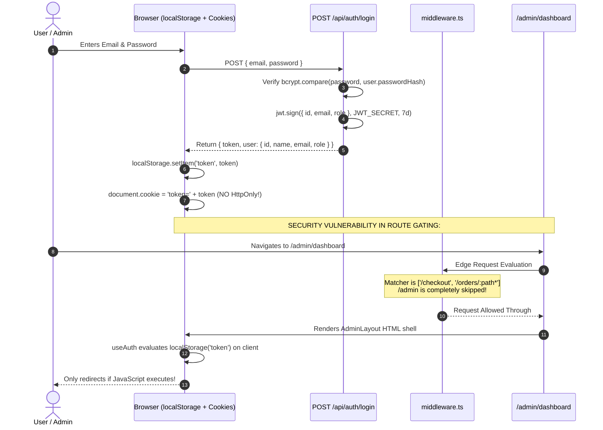

# 07 — Authentication, Authorization & Security Audit

## 1. Authentication Architecture & Flow Diagram



---

## 2. Token Handling & Session Management Audit

### 2.1 Storage Mechanism Vulnerability
- **Token Storage**: JWT tokens are written directly to `window.localStorage` in [`app/login/page.tsx`](file:///c:/B.tech/3rd%20sem/DBMS/Project/app/login/page.tsx#L32) and [`app/register/page.tsx`](file:///c:/B.tech/3rd%20sem/DBMS/Project/app/register/page.tsx#L114).
- **Security Implication**: `localStorage` is accessible to any script running in the browser origin. Any Cross-Site Scripting (XSS) vulnerability will lead to immediate exfiltration of customer and administrator JWT tokens.
- **Client Cookie Setting**:
  ```ts
  document.cookie = `token=${data.token}; path=/; max-age=86400; SameSite=Lax`
  ```
  Setting cookies via client JavaScript prevents using the `HttpOnly` flag, defeating browser protections against credential theft.

### 2.2 NextAuth vs Custom JWT Inconsistency
- The system maintains two parallel authentication systems:
  1. Custom JWT for standard email/password registration and login.
  2. NextAuth 4.24.14 configured in [`app/api/auth/[...nextauth]/route.ts`](file:///c:/B.tech/3rd%20sem/DBMS/Project/app/api/auth/[...nextauth]/route.ts) for Google OAuth.
- Users logging in through Google receive a NextAuth session cookie (`next-auth.session-token`), but the core orders, checkout, and admin endpoints expect `Authorization: Bearer <token>` in request headers, causing Google-authenticated users to encounter authorization failures unless patched.

---

## 3. Vulnerability Audit & CVE Analysis (`npm audit`)

The dependency scan reveals **37 active security advisories** (3 Critical, 26 High, 7 Moderate, 1 Low):

| Package | Severity | Advisory ID | Vulnerability Details |
| :--- | :---: | :--- | :--- |
| **`next`** (16.2.6) | **CRITICAL** | GHSA-p293-qw3h-jr36 | **Unauthenticated Remote Code Execution (RCE)** on Windows-hosted servers. |
| **`next`** (16.2.6) | **CRITICAL** | GHSA-2xp9-vwfh-vxw4 | Remote Code Execution in Image Optimization API when AVIF files are used. |
| **`next`** (16.2.6) | **HIGH** | GHSA-6gpp-xcg3-4w24 | Middleware / Proxy bypass in App Router applications. |
| **`next`** (16.2.6) | **HIGH** | GHSA-m99w-x7hq-7vfj | Denial of Service in App Router using Server Actions. |
| **`next-auth`** (4.24.14) | **CRITICAL** | GHSA-7rqj-j65f-68wh | Email normalizer validates address before Unicode normalization (Homoglyph @ bypass). |
| **`next-auth`** (4.24.14) | **HIGH** | GHSA-xmf8-cvqr-rfgj | `getToken()` throws uncaught exception on malformed Bearer authorization headers. |
| **`proxy-addr`** (2.0.7) | **CRITICAL** | GHSA-jqcg-44mw-7w3h | IP address spoofing via IPv4-mapped IPv6 trust subnet. |
| **`source-map-js`** | **HIGH** | GHSA-68fv-2mgg-jv7q | Event-loop Denial of Service via indexed source-map section offsets. |
| **`nanoid`** (3.3.17) | **HIGH** | GHSA-28wg-ghj8-5hjv | Non-secure generator infinite loop DoS. |

---

## 4. Secrets Management & Hardcoded Credentials

1. **Missing `.env.example`**:
   - The repository lacks an environment template file. Developers have no specification of mandatory environment variables (`DATABASE_URL`, `JWT_SECRET`, `GOOGLE_CLIENT_ID`, `GOOGLE_CLIENT_SECRET`).
2. **Missing Startup Guard**:
   - `process.env.JWT_SECRET!` is used with TypeScript non-null assertions across API routes without verifying its existence at boot time.
3. **Hardcoded Phone Numbers**:
   - Customer support WhatsApp number `8109142426` is hardcoded directly inside [`components/ui/product-detail.tsx`](file:///c:/B.tech/3rd%20sem/DBMS/Project/components/ui/product-detail.tsx#L202).
4. **OAuth Placeholder Values in Seed**:
   - In [`prisma/seed.ts`](file:///c:/B.tech/3rd%20sem/DBMS/Project/prisma/seed.ts), seeded admin and demo user passwords are listed in plain text (`admin1234`, `demo1234`). While appropriate for seeding dev environments, a production seeder must require dynamic secrets.

---

## 5. Security Issues & Remediation Table

| File Path | Issue | Severity | Fix Suggestion |
| :--- | :--- | :--- | :--- |
| [`middleware.ts`](file:///c:/B.tech/3rd%20sem/DBMS/Project/middleware.ts#L24) | Server middleware fails to protect `/admin/:path*` and `/api/admin/:path*`. | **Critical** | Add `/admin/:path*` to `matcher` and reject requests without valid admin token server-side. |
| [`package.json`](file:///c:/B.tech/3rd%20sem/DBMS/Project/package.json#L25) | Next.js 16.2.6 contains unauthenticated Remote Code Execution vulnerabilities on Windows. | **Critical** | Upgrade Next.js to `>= 16.4.2` (`npm audit fix --force`). |
| [`app/login/page.tsx`](file:///c:/B.tech/3rd%20sem/DBMS/Project/app/login/page.tsx#L32) | JWT stored in `localStorage` and set via non-HttpOnly `document.cookie`. | **High** | Issue `Set-Cookie: token=...; HttpOnly; Secure; SameSite=Strict` from `/api/auth/login` route. |
| [`app/api/auth/[...nextauth]/route.ts`](file:///c:/B.tech/3rd%20sem/DBMS/Project/app/api/auth/[...nextauth]/route.ts#L23) | Sets `passwordHash: 'google-oauth'` as placeholder for Google users. | **Medium** | Make `passwordHash String?` optional in Prisma schema for federated OAuth accounts. |
| Repo Root | Missing `.env.example` documentation for required deployment secrets. | **Medium** | Create `.env.example` declaring all mandatory environment variables. |
