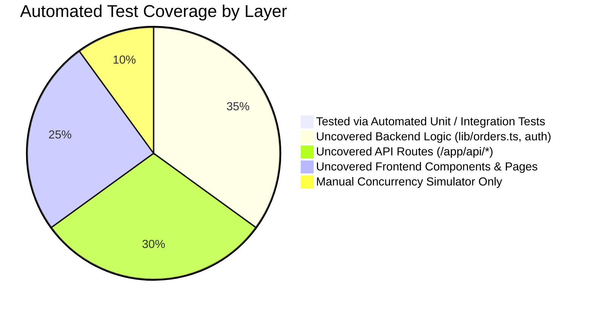
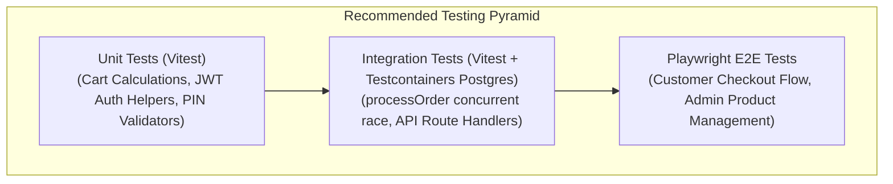

# 09 — Testing & Quality Assurance Audit

## 1. Test Suite Discovery & Status

```
Automated Test Files Found: 0
Test Runners Configured:     None (No Jest, Vitest, Cypress, or Playwright)
Test Script in package.json: MISSING ("scripts.test" does not exist)
Overall Automated Coverage:  0.0%
```

The repository currently contains **no automated test infrastructure**. Quality assurance has historically relied exclusively on manual browser verification and an interactive in-app admin concurrency simulator.

---

## 2. Test Coverage Gap Analysis by Layer



| Application Layer | Existing Tests | Automated Coverage | Risk Assessment |
| :--- | :---: | :---: | :--- |
| **Concurrency Engine (`lib/orders.ts`)** | None | **0%** | **CRITICAL**: Financial transactions & stock decrement logic could regress during refactors without detection. |
| **Authentication & Guards (`lib/auth.ts`)** | None | **0%** | **CRITICAL**: Role checking (`isAdmin`) and token decoding are unprotected by regression tests. |
| **API Route Handlers (`app/api/*`)** | None | **0%** | **HIGH**: 26 endpoints run without automated contract or integration tests. |
| **Database Constraints & Triggers** | None | **0%** | **MEDIUM**: Check constraints and triggers (`sync_is_in_stock`) are only verified when running manual migrations. |
| **Frontend Checkout & Cart Flow** | None | **0%** | **HIGH**: Cart calculation and multi-step checkout form validation lack automated E2E tests. |

---

## 3. Semi-Automated Testing: The Concurrency Stress Simulator

While lacking standard test runners, the codebase includes an innovative **in-app concurrency stress testing harness**:
- **Backend Route**: [`app/api/admin/simulate-race/route.ts`](file:///c:/B.tech/3rd%20sem/DBMS/Project/app/api/admin/simulate-race/route.ts)
- **Frontend Dashboard Trigger**: [`app/admin/dashboard/page.tsx`](file:///c:/B.tech/3rd%20sem/DBMS/Project/app/admin/dashboard/page.tsx#L94)
- **How It Works**:
  1. The administrator selects a target product (e.g., a flower bouquet with `stock = 1`).
  2. The harness fires 50 simultaneous parallel asynchronous promises using `Promise.allSettled`.
  3. Each promise simulates a distinct buyer user placing an order via `processOrder()`.
  4. The engine records how many succeeded (1), how many were cleanly rejected with `OUT_OF_STOCK` (49), and verifies that database `negativeStockRows === 0`.
  5. The stock is automatically restored to its pre-test level if `resetAfter: true`.

*Limitation*: Because this test is executed via an HTTP POST request in the admin UI, it cannot be run automatically in headless CI/CD pipelines.

---

## 4. Recommended Test Strategy & Implementation Roadmap



### 4.1 Recommended Frameworks
1. **Unit & Integration**: **Vitest**
   - Native ESM and TypeScript support with near-instant execution speed.
   - Seamless compatibility with Next.js 16 and Prisma.
2. **End-to-End (E2E)**: **Playwright**
   - Headless browser automation testing the full user journey: adding products to cart, filling shipping info, and verifying orders in the admin panel.

### 4.2 Priority Test Cases to Implement Immediately
1. **Order Engine Race Test**:
   - Spawn 50 worker threads against a real PostgreSQL testcontainer. Assert that exactly `N` orders succeed when stock is `N`, and zero overselling occurs.
2. **Auth Token Expiration Test**:
   - Verify that expired tokens or tokens with modified roles are rejected with `401 Unauthorized`.
3. **Price Tampering Test**:
   - Submit an order payload with client price `₹1` for an item priced at `₹999`. Verify that server recalculates and charges `₹999`.

---

## 5. Testing Issues & Gaps Table

| File Path | Issue | Severity | Fix Suggestion |
| :--- | :--- | :--- | :--- |
| [`package.json`](file:///c:/B.tech/3rd%20sem/DBMS/Project/package.json#L5) | Missing `"test"` script in `package.json`. | **High** | Install `vitest` and configure `"test": "vitest run"`. |
| [`lib/orders.ts`](file:///c:/B.tech/3rd%20sem/DBMS/Project/lib/orders.ts) | Core transaction engine lacks automated test coverage outside of the manual admin UI simulator. | **High** | Extract concurrency simulation into an automated integration test script. |
| Whole Repo | 0% automated test coverage across all components and endpoints. | **High** | Establish baseline testing suite with Vitest and Playwright. |
