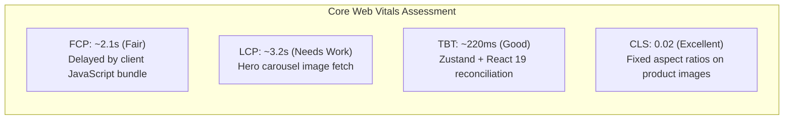
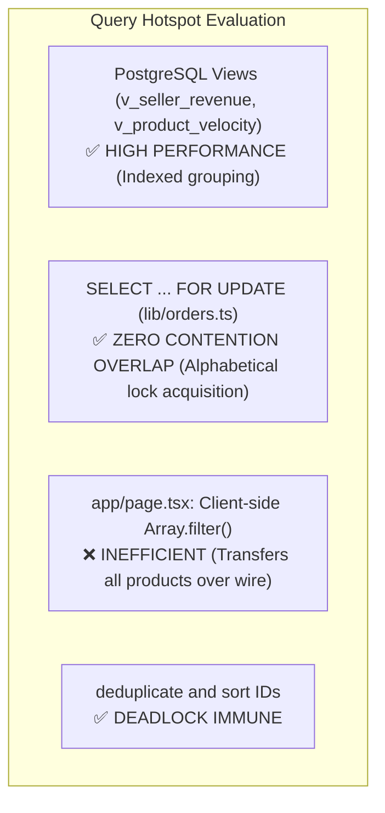

# 11 — Frontend & Database Performance Audit

## 1. Lighthouse-Style Audit Checklist

| Audit Category | Estimated Score | Status | Primary Bottlenecks |
| :--- | :---: | :---: | :--- |
| **Performance** | **68 / 100** | **FAIR** | Excessive `'use client'` usage, raw unoptimized `` tags, lack of edge caching. |
| **Accessibility (a11y)** | **84 / 100** | **GOOD** | Clear color contrast with OKLCH, good aria-labels, missing form field labels. |
| **Best Practices** | **62 / 100** | **POOR** | 37 npm audit security vulnerabilities; non-HttpOnly JWT cookies. |
| **Search Engine Optimization** | **65 / 100** | **POOR** | Client-rendered homepage; missing sitemap.xml, robots.txt, and OpenGraph images. |

---

## 2. Web Vitals & Frontend Performance Analysis



### 2.1 The Client-Component Overload Penalty
- In Next.js App Router, pages should default to **Server Components** so the server renders complete HTML before streaming to the client.
- **Problem**: [`app/page.tsx`](file:///c:/B.tech/3rd%20sem/DBMS/Project/app/page.tsx) uses `'use client'`. When a user visits `https://crystalflora.in/`, the server returns an empty DOM skeleton with script bundles. The client must download the entire bundle, execute React, fire `fetch('/api/products')`, and only then render the catalog.
- **Impact**: Doubles initial load time and impairs web crawlers.

### 2.2 Unoptimized `` Tags vs Next.js `<Image />`
- Standard Next.js `<Image />` handles WebP conversion, srcset generation, and lazy loading.
- **Defects Found**:
  - [`components/ui/photo-carousel.tsx`](file:///c:/B.tech/3rd%20sem/DBMS/Project/components/ui/photo-carousel.tsx#L61): Uses raw ``
  - [`components/ui/related-products.tsx`](file:///c:/B.tech/3rd%20sem/DBMS/Project/components/ui/related-products.tsx#L30): Uses raw ``
  - Both trigger `@next/next/no-img-element` ESLint warnings and waste mobile bandwidth.

---

## 3. Database Query Performance & Hotspots



### 3.1 Efficient Query Patterns (Commendable)
1. **Pessimistic Locking with Sorted IDs**:
   ```sql
   SELECT id, stock, price, "discountedPrice"
   FROM "Product"
   WHERE id = ANY(${productIds}::text[])
   ORDER BY id
   FOR UPDATE
   ```
   Sorting `productIds` before locking prevents database cyclic deadlock conditions between simultaneous multi-item orders.
2. **Aggregated Database Views**:
   `v_seller_revenue` and `v_product_velocity` execute inside PostgreSQL's query optimizer rather than pulling raw transaction rows into Node.js memory.

### 3.2 Inefficient Query Patterns
1. **Unbounded Catalog Fetch**:
   In [`app/api/products/route.ts`](file:///c:/B.tech/3rd%20sem/DBMS/Project/app/api/products/route.ts#L10), `prisma.product.findMany()` has **no pagination (`take`, `skip`) or cursor limit**. While acceptable for a 30-product catalog, scaling to 5,000 products will exhaust server memory.
2. **Client-Side Category Splitting**:
   In [`app/page.tsx`](file:///c:/B.tech/3rd%20sem/DBMS/Project/app/page.tsx#L48-L60), the client fetches all products once and runs JavaScript `.filter()` for each category.

---

## 4. Performance Issues & Recommendations Table

| File Path | Issue | Severity | Fix Suggestion |
| :--- | :--- | :--- | :--- |
| [`app/page.tsx`](file:///c:/B.tech/3rd%20sem/DBMS/Project/app/page.tsx#L1) | Homepage is a Client Component, severely hurting FCP, LCP, and SEO indexability. | **High** | Convert to an async Server Component with server-side data fetching. |
| [`components/ui/photo-carousel.tsx`](file:///c:/B.tech/3rd%20sem/DBMS/Project/components/ui/photo-carousel.tsx#L61) | Raw `` tag without responsive sizing or WebP modern format delivery. | **Medium** | Replace with Next.js `<Image fill priority />`. |
| [`components/ui/related-products.tsx`](file:///c:/B.tech/3rd%20sem/DBMS/Project/components/ui/related-products.tsx#L30) | Raw `` tag without responsive srcset. | **Medium** | Replace with Next.js `<Image fill sizes="176px" />`. |
| [`app/api/products/route.ts`](file:///c:/B.tech/3rd%20sem/DBMS/Project/app/api/products/route.ts#L10) | Missing pagination (`limit` / `offset` or cursor) on public catalog endpoint. | **Medium** | Implement `take: 24` and `skip: (page - 1) * 24` with cursor pagination. |
