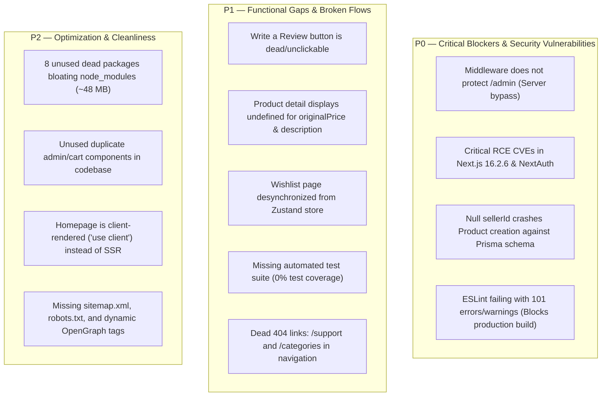

# 14 — Task Memory, Known Issues & Backlog

## 1. Architectural Decisions Log (ADR Snapshot)

| Decision | Rationale | Trade-off / Technical Debt |
| :--- | :--- | :--- |
| **Serializable PostgreSQL Isolation for Orders** | Eliminates race conditions and prevents inventory overselling during flash sales. | Requires explicit deadlock handling and exponential backoff retries in `lib/orders.ts`. |
| **Pre-computed SQL Views for Analytics** | Offloads complex multi-table joins from Node.js runtime to PostgreSQL's native query engine. | Requires custom SQL migration files that Prisma cannot generate automatically from `schema.prisma`. |
| **Zustand with LocalStorage Persistence** | Provides fast, zero-latency cart updates across page reloads without requiring server roundtrips. | Cart items in `localStorage` can become stale if prices or stock change on the backend. |
| **Cash on Delivery (COD) as Initial Payment Gate** | Enables immediate checkout testing without requiring live merchant banking credentials. | Leaves `razorpay` package as dead code in `package.json`. |
| **Dual NextAuth + Custom JWT Setup** | Accommodated both Google Social Login and standard Email/Password accounts. | Created fragmented session handling, non-HttpOnly cookie exposure, and auth sync bugs. |

---

## 2. Active Blockers & Known Issues Summary

---

## 3. Prioritized Project Backlog

### P0 — Critical (Immediate Fixes Required)
- [ ] **SEC-01**: Update [`middleware.ts`](file:///c:/B.tech/3rd%20sem/DBMS/Project/middleware.ts) matcher to include `/admin/:path*` and `/api/admin/:path*`; reject unauthenticated visitors server-side.
- [ ] **SEC-02**: Run `npm install next@latest next-auth@latest` to eliminate critical RCE (GHSA-p293-qw3h-jr36) and homoglyph bypass vulnerabilities.
- [ ] **BUG-01**: Fix `sellerId` schema mismatch in [`app/api/admin/products/route.ts`](file:///c:/B.tech/3rd%20sem/DBMS/Project/app/api/admin/products/route.ts#L64) and [`prisma/schema.prisma`](file:///c:/B.tech/3rd%20sem/DBMS/Project/prisma/schema.prisma#L50).
- [ ] **DEV-01**: Create `.env.example` declaring all required secrets (`DATABASE_URL`, `JWT_SECRET`, `GOOGLE_CLIENT_ID`, `GOOGLE_CLIENT_SECRET`).
- [ ] **LINT-01**: Resolve 101 ESLint errors and warnings across the project so `npm run lint` passes cleanly.

### P1 — High Priority (Functional Integrity & Core UX)
- [ ] **FEAT-01**: Implement the "Write a Review" modal dialog in [`components/ui/reviews-section.tsx`](file:///c:/B.tech/3rd%20sem/DBMS/Project/components/ui/reviews-section.tsx) and wire it to `POST /api/reviews`.
- [ ] **BUG-02**: Correct property mapping in [`components/ui/product-detail.tsx`](file:///c:/B.tech/3rd%20sem/DBMS/Project/components/ui/product-detail.tsx): replace `product.originalPrice` and `product.fullDescription` with database fields.
- [ ] **STATE-01**: Refactor [`app/wishlist/page.tsx`](file:///c:/B.tech/3rd%20sem/DBMS/Project/app/wishlist/page.tsx) to consume `useWishlistStore` directly to keep navbar badges and page content in sync.
- [ ] **CLEAN-01**: Delete duplicate [`components/cart/bottom-nav.tsx`](file:///c:/B.tech/3rd%20sem/DBMS/Project/components/cart/bottom-nav.tsx) and fix the broken `/categories` link.
- [ ] **CLEAN-02**: Create `/support` page or update profile menu link to open WhatsApp/Email support modal.
- [ ] **TEST-01**: Configure Vitest and write an integration test suite for `lib/orders.ts` concurrency transactions.

### P2 — Medium Priority (Performance & Architecture Cleanup)
- [ ] **PERF-01**: Convert [`app/page.tsx`](file:///c:/B.tech/3rd%20sem/DBMS/Project/app/page.tsx) to an async Server Component with server-side catalog data loading.
- [ ] **DEP-01**: Remove 8 unused dependencies from `package.json` (`@tanstack/react-query`, `zod`, `react-hook-form`, `razorpay`, `cloudinary`, etc.).
- [ ] **DEP-02**: Move `shadcn` from `dependencies` to `devDependencies`.
- [ ] **PERF-02**: Replace raw `` tags in `photo-carousel.tsx` and `related-products.tsx` with optimized Next.js `<Image />`.
- [ ] **SEO-01**: Implement `generateMetadata()` in [`app/products/[id]/page.tsx`](file:///c:/B.tech/3rd%20sem/DBMS/Project/app/products/[id]/page.tsx).
- [ ] **SEO-02**: Create `app/sitemap.ts` and `app/robots.ts`.

---

## 4. Issues Tracking Table

| File Path | Issue | Severity | Status |
| :--- | :--- | :---: | :---: |
| [`middleware.ts`](file:///c:/B.tech/3rd%20sem/DBMS/Project/middleware.ts) | Server middleware excludes admin routes | **P0** | Open |
| [`package.json`](file:///c:/B.tech/3rd%20sem/DBMS/Project/package.json) | 3 critical and 26 high security CVEs | **P0** | Open |
| [`app/api/admin/products/route.ts`](file:///c:/B.tech/3rd%20sem/DBMS/Project/app/api/admin/products/route.ts) | Null `sellerId` crashes against Prisma schema | **P0** | Open |
| Project Root | Missing `.env.example` | **P0** | Open |
| [`components/ui/reviews-section.tsx`](file:///c:/B.tech/3rd%20sem/DBMS/Project/components/ui/reviews-section.tsx) | "Write a Review" button lacks click handler | **P1** | Open |
| [`components/ui/product-detail.tsx`](file:///c:/B.tech/3rd%20sem/DBMS/Project/components/ui/product-detail.tsx) | Displays undefined for `originalPrice` & `description` | **P1** | Open |
| [`app/wishlist/page.tsx`](file:///c:/B.tech/3rd%20sem/DBMS/Project/app/wishlist/page.tsx) | Desynchronized from Zustand store | **P1** | Open |
| [`components/cart/bottom-nav.tsx`](file:///c:/B.tech/3rd%20sem/DBMS/Project/components/cart/bottom-nav.tsx) | Broken `/categories` 404 link | **P1** | Open |
